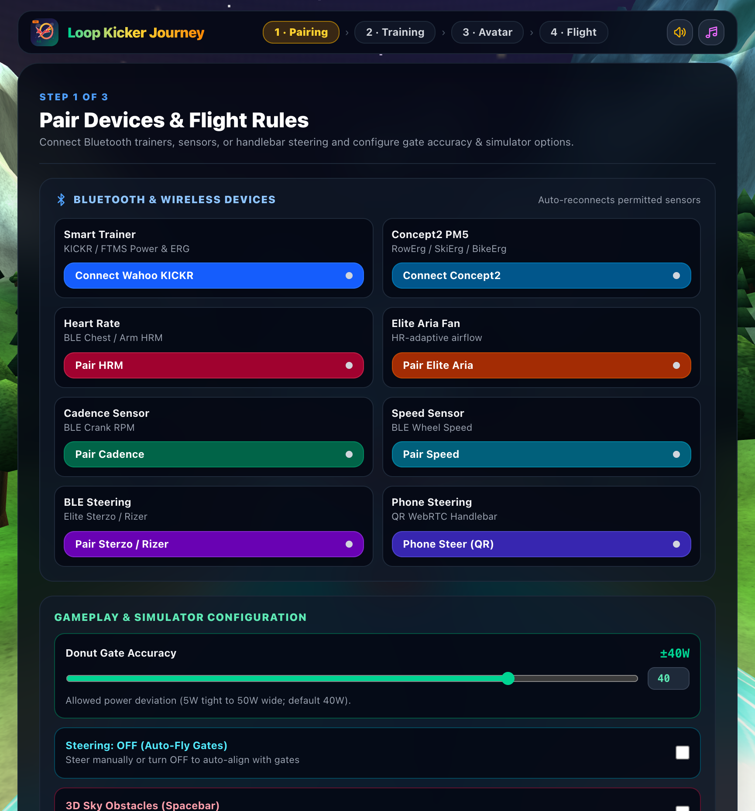
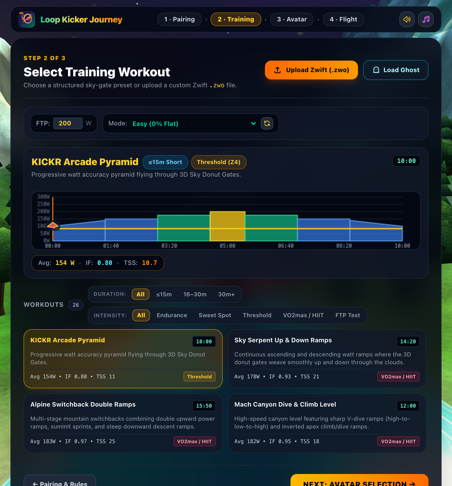
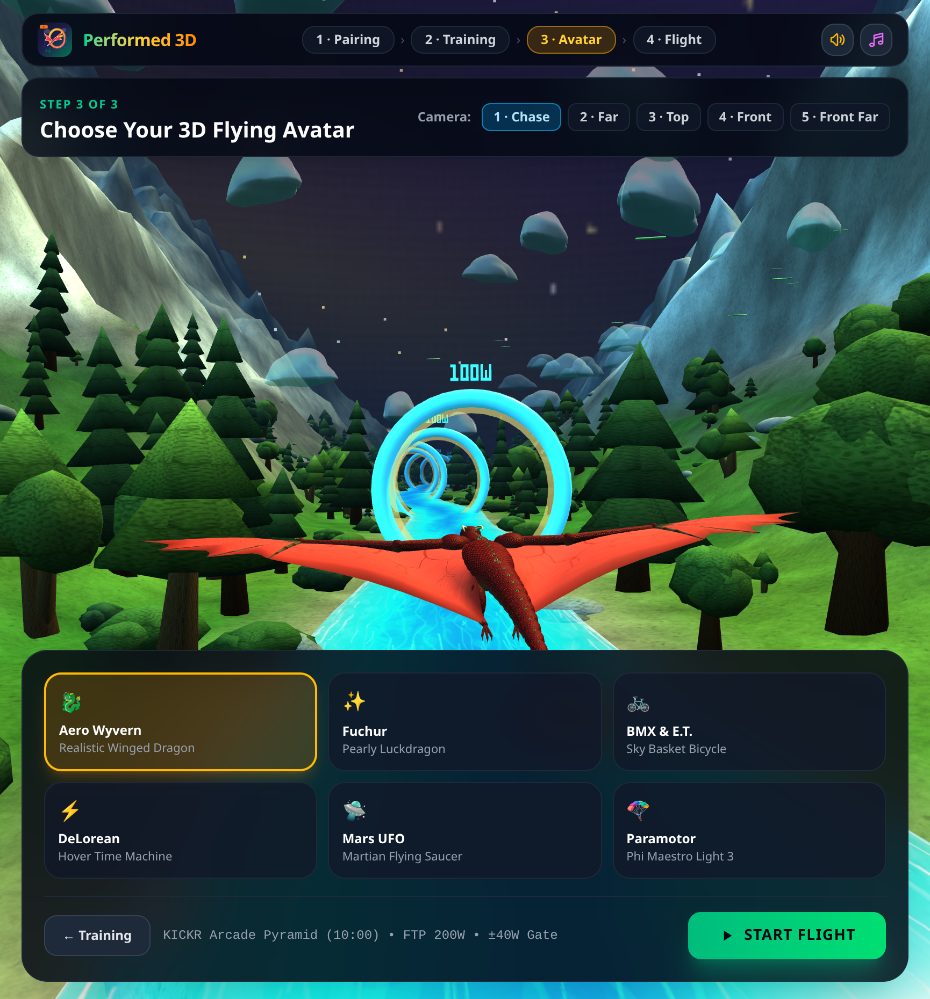

# Loop Kicker Journey

Loop Kicker Journey is a browser-based 3D cycling game for structured indoor cycling workouts. A workout profile sets power targets; power from a connected trainer is measured and its resistance is controlled according to the selected mode. At the same time, an avatar flies through an animated sky filled with donut gates. Optionally, you can shoot obstacles and steer manually.

## Feature Requests

- Multiplay
- Ranking server

## Quick start

No server or package installation is required. The page loads Three.js and Tailwind CSS at runtime from CDNs, so an internet connection is required.

1. Clone or download the repository.
2. Open `index.html` directly in Chrome or another browser that supports Web Bluetooth.
3. Step through the setup screens and take off:
   - **Splashscreen:** Click **Start Setup** from the dragon hero screen.
   - **1 · Pairing & Rules:** Pair Bluetooth devices (or enable the Virtual Trainer Simulator and **Auto-Fly Target Gate**), toggle steering and 3D obstacles, and set **Donut Gate Accuracy** (`40 W` by default).
   - **2 · Training Selection:** Filter the 26 built-in presets by duration (`≤15m`, `16–30m`, `30m+`) and intensity (`Endurance`, `Sweet Spot`, `Threshold`, `VO2max / HIIT`, `FTP Test`), upload a Zwift `.zwo` file, or load a saved `.ghost.json` ghost ride, then set your FTP, preview expected **Avg** watts / **IF** / **TSS**, and choose a resistance/wind mode.
   - **3 · Avatar Selection:** Choose your 3D avatar and camera view over a live sky preview, then click **Start Flight**.
   - **4 · Flight & Summary:** Fly through the target-watt donut gates and finish to view the **Workout Summary** screen (`.fit`, `.ghost.json`, and `.png` export).

Simulation mode is enabled by default, so you can try the game without a trainer. Bluetooth requires a compatible browser; the Web Bluetooth API is supported by browsers such as current versions of Chrome and Edge. Bluetooth is available only in a secure context (for example, `localhost` or HTTPS).

For an HTTPS deployment behind a reverse proxy, set `APP_ORIGIN` to the public origin in the server environment.

## Gameplay and workout controls

Your current power is compared with the workout's target power. The game displays power accuracy, workout intervals, and progress in the HUD. Clearing consecutive donut gates in-zone builds your combo multiplier and awards tiered **Ring Streak** bonuses every 15 rings (`+250` points per tier, from *Nice Streak!* to *Legendary!*) with visual splash banners and ascending arpeggios. FTP (200 W by default; adjustable from 50 to 600 W) is used to calculate power targets specified as a percentage of FTP. Use **Donut Gate Accuracy** on the **Pairing & Rules** screen to set the allowed power deviation (40 W by default).

Available workouts can be filtered by duration and physiological intensity:

- **Arcade & Ramp Challenges:** **KICKR Arcade Pyramid**, **Quick 3-Minute Accuracy Sprint**, **Sky Serpent Up & Down Ramps**, **Alpine Switchback Double Ramps**, **Mach Canyon Dive & Climb Level**, **Dragon Boss Mega-Ramp Gauntlet**, **Dragon Canyon Rollercoaster**, and **Alpine Sawtooth Multi-Peak**
- **Physiologically Structured Workouts:** **Active Recovery Flush (Z1)**, **Mitochondrial Zone 2 Base**, **Polarized LT1 Aerobic Cruiser**, **2×12m Sweet Spot Builder**, **Muscular Force Tempo (SE)**, **MCT1 Lactate Shuttle Over-Unders**, **2×15m MLSS Threshold Cruise**, **Rønnestad 30/15 VO2max Blocks**, **Norwegian 4×4m VO2max Cardiac**, and **Billat Fast-Start VO2 Kinetics**
- **HIIT & Race Simulations:** **30/15 VO2max Micro-Burst Storm**, **Dragon Fire Tabata Inferno**, **Over-Under Surge Blitz**, **Harmonic Wave & Step Matrix**, **Sweet Spot Precision**, and **Pro Criterium Corner Sprints**
- **FTP Ramp Tests:** **Standard MAP / FTP Ramp Test** (`+20 W/min` up to `580 W`) and **Lite / Finer-Step FTP Ramp Test (+10W)** (`+10 W/min` up to `560 W`) — progressive 1-minute fixed-watt ramps ridden to exhaustion, estimating FTP values past `400 W` regardless of your prior FTP setting. An active FTP Test badge is shown in the HUD, and stopping pedaling for 5 seconds automatically finishes the flight, displays your calculated FTP (`75%` of best 1-minute average power) prominently in the summary, and saves it to `localStorage` as your default FTP for future trainings.
- **Custom Zwift workouts** in `.zwo` format

Resistance modes are **Easy**, **Medium**, **Difficult**, and **ERG Lock** (with a button to re-roll the session's random wind profile). In **Medium** and **Difficult** modes, simulated upwind thermals and downwind drafts are shown directly on upcoming donut gates with animated emerald lift or amber draft 3D chevrons, flanking wind halos, and slope badges. During a flight, **Pause Flight** / **Resume Flight** pauses or resumes the workout, and **Finish & Summary** ends a workout early.

### Adaptive music

While flying, a procedurally generated soundtrack (Web Audio, no audio files) follows the target power of the next ring (donut gate) ahead, relative to FTP. Your actual pedaled watts do not affect it, so the music tracks the workout's intervals. Tempo, key, instruments, and brightness change with the ring targets:

| Mood | Ring target (% FTP) | Sound |
| --- | --- | --- |
| **Drift** | < 35 % | 76 BPM, soft major pads and sparse bells, no drums |
| **Cruise** | 35–68 % (warm-up/cool-down) | 92 BPM, warm pads, soft kick, gentle arpeggio |
| **Groove** | 68–90 % | 112 BPM, groove beat, plucked bass, 8th-note arpeggio |
| **Drive** | 90–106 % | 128 BPM, minor key, four-on-the-floor, saw bass, 16th-note arpeggio |
| **Inferno** | > 106 % | 146 BPM, full drums with fills, rolling bass, sawtooth lead |

Transitions are smoothed so short target changes don't toggle the music. The music (note) button in the header turns the soundtrack on or off. The speaker button mutes all audio, including the music; while muted, the music button is disabled.

## Controls

| Key | Action |
| --- | --- |
| `←` / `A` | Steer left |
| `→` / `D` | Steer right |
| `1`–`5` | Change camera view |
| `Space` | Breathe dragon fire to fend off obstacles |
| `↑` / `↓` | Increase/decrease power by 10 W in simulation mode |
| `Shift` + `↑` / `↓` | Increase/decrease power by 25 W in simulation mode |

You can turn off manual steering to have the avatar automatically steer through the gates. Obstacles can be enabled or disabled with the corresponding option.

## Avatars and cameras

Available avatars:

- Aero Wyvern
- Fuchur
- Boy with Bicycle & E.T.
- DeLorean
- UFO
- Paramotor (pilot with a caged propeller under a white/lilac Phi Maestro Light 3 paraglider)

There are five camera views: Chase, Far Chase, Top-Down, Front, and Front Far. Your avatar, camera, FTP, steering, and accuracy settings are saved in the browser.

## Connecting trainers and sensors

Use the BLE buttons to pair supported devices:

- Wahoo KICKR (power and trainer control)
- Concept2 RowErg, SkiErg, or BikeErg via the PM5 monitor (power, stroke rate shown as cadence, speed, and heart rate from a strap paired to the PM5). The PM5 cannot be controlled, so resistance modes and ERG Lock have no effect; you set the effort yourself.
- Heart rate monitors
- Cadence and speed sensors
- Elite Sterzo Smart or Elite Rizer (BLE steering)
- Mobile phone handlebar steering via QR code (WebRTC peer-to-peer): Click **Phone Steer (QR)** on the desktop to display a QR code. Scanning it on your phone opens a minimalistic mobile steering controller page (`?phone-steer=<id>`) with sensor permission handling, live angle gauge, **Calibrate Center (0°)**, axis inversion, touch test slider, and a **Dragon Fire** button—without requiring `server.js` or typing IP addresses.
- Elite Aria Smart Fan

Bluetooth devices must be powered on and within range. Start pairing from the corresponding control in the interface. Without a trainer, use simulation mode; power can be adjusted with the slider or arrow keys.

### Automatic reconnection

Previously paired Bluetooth devices reconnect automatically when the page loads and whenever they come back into range. This uses the Web Bluetooth `getDevices()` API, which is enabled by default only from Chrome 169. In earlier Chrome or Edge versions, enable it manually:

1. Open `chrome://flags/#enable-web-bluetooth-new-permissions-backend` (in Edge: `edge://flags/#enable-web-bluetooth-new-permissions-backend`).
2. Set the flag to **Enabled** and restart the browser.
3. Pair each device once more using its button so that the browser remembers the permission.

Without this flag, devices must be paired manually after every page load. Messages prefixed with `[BLE auto-connect]` in the browser console show which devices were found and whether a connection succeeded.

## Custom workouts and results

- **Load a Zwift workout:** Select a `.zwo` file using **Upload Zwift (.zwo)**. Supported interval types include SteadyState, Warmup, Cooldown, Ramp, IntervalsT, FreeRide, and MaxEffort (plus `<ftpTest>true</ftpTest>` or "Ramp Test" / "FTP Test" in `<name>` for custom FTP tests).
- **Save a FIT file:** After the workout, review your rank, gate accuracy, and power metrics (**Avg Power**, **TSS**, **NP**, **IF**, **Work**), then click **Download .FIT** to export the recorded activity for Strava, Garmin Connect, or another training platform.
- **Garmin Connect:** Direct activity uploads require access to Garmin's Business Developer Program Activity API, which provides push access. Garmin's personal API access is pull-only. Until business access is available, download the FIT file and import it into Garmin Connect manually.
- **Save a screenshot:** An in-game screenshot (including the HUD and bottom workout timeline overlay) is captured automatically at the end of a flight or anytime via **Screenshot**, and can be downloaded from the summary via **Save .PNG**.
- **Ghost rides:** Click **Save Ghost** in the summary to download the ride as a `.loop-kicker-journey-ghost.json` file. The file contains the workout plus your watts, distance, and score for every second. Before starting a ride, click **Load Ghost** on the **Training Selection** screen to race against a saved ride; its workout is loaded automatically. A translucent cyan copy of your avatar flies beside you. Its altitude follows the ghost's watts, and it moves ahead or behind according to the distance gap. The HUD shows your distance gap, the ghost's watts, and your score difference, and the summary reports who won. Existing `.ghost.json` files remain supported.

## Screenshots

| View | Screenshot |
| --- | --- |
| Splashscreen |  |
| Step 1 · Pairing & Rules |  |
| Step 2 · Training Selection |  |
| Step 3 · Avatar Selection |  |
| Flight |  |
| DeLorean avatar |  |
| UFO, standard view |  |
| UFO, top-down view |  |
| Front camera |  |
| Fuchur avatar |  |
| Paramotor avatar |  |
| Workout summary |  |

## Project files

- [`index.html`](index.html) – Page markup (screens, HUD, modals) and the ordered list of scripts
- [`css/styles.css`](css/styles.css) – Custom animations and styles (Tailwind utility classes are used inline)
- [`js/`](js/) – Application code as plain browser scripts (no build step). They share one global scope and are loaded in this order by `index.html`:
  - [`mobile-controller.js`](js/mobile-controller.js) – Standalone phone steering controller (`?phone-steer=<id>`)
  - [`workouts.js`](js/workouts.js) – Preset workouts and Zwift `.zwo` parser
  - [`fit-encoder.js`](js/fit-encoder.js) – Binary `.fit` file export
  - [`audio-synth.js`](js/audio-synth.js) / [`music.js`](js/music.js) – Sound effects and adaptive procedural music
  - [`bluetooth.js`](js/bluetooth.js) – Web Bluetooth trainer, heart rate, speed/cadence, and steering devices
  - [`particles.js`](js/particles.js) – Particle and overlay effects
  - [`game-state.js`](js/game-state.js) – Main game state and scoring logic
  - [`dragon-sky-3d.js`](js/dragon-sky-3d.js) – Three.js world, gates, obstacles, and avatars (`DragonSky3DEngine`)
  - [`scoring-timeline.js`](js/scoring-timeline.js) – Scoring helpers and timeline canvas
  - [`hud.js`](js/hud.js) – Live HUD and 1 Hz workout tick
  - [`ghost-rides.js`](js/ghost-rides.js) – Saving and racing ghost rides
  - [`main.js`](js/main.js) – Event listeners and initialization (must stay last)
- [`server.js`](server.js) – Local static web server
- [`.env.example`](.env.example) – Example server configuration
- [`loop-kicker-journey-models.js`](loop-kicker-journey-models.js) – 3D models
- [`sterzo-challenge-codes.js`](sterzo-challenge-codes.js) – Sterzo challenge/response table; the source code attributes it to `pycycling` under the MIT license
- [`loop-kicker-journey.svg`](loop-kicker-journey.svg) – Logo and favicon
- [`docs/screenshots/`](docs/screenshots/) – Documentation screenshots
