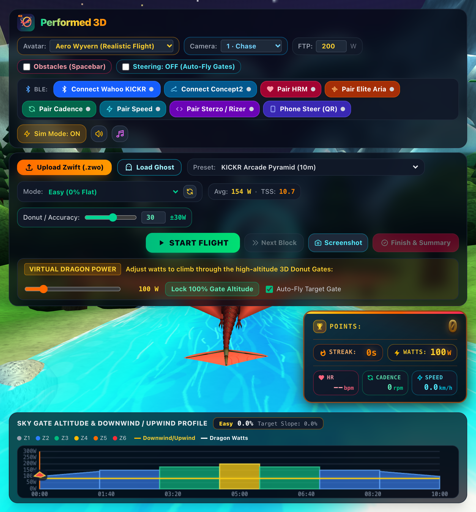
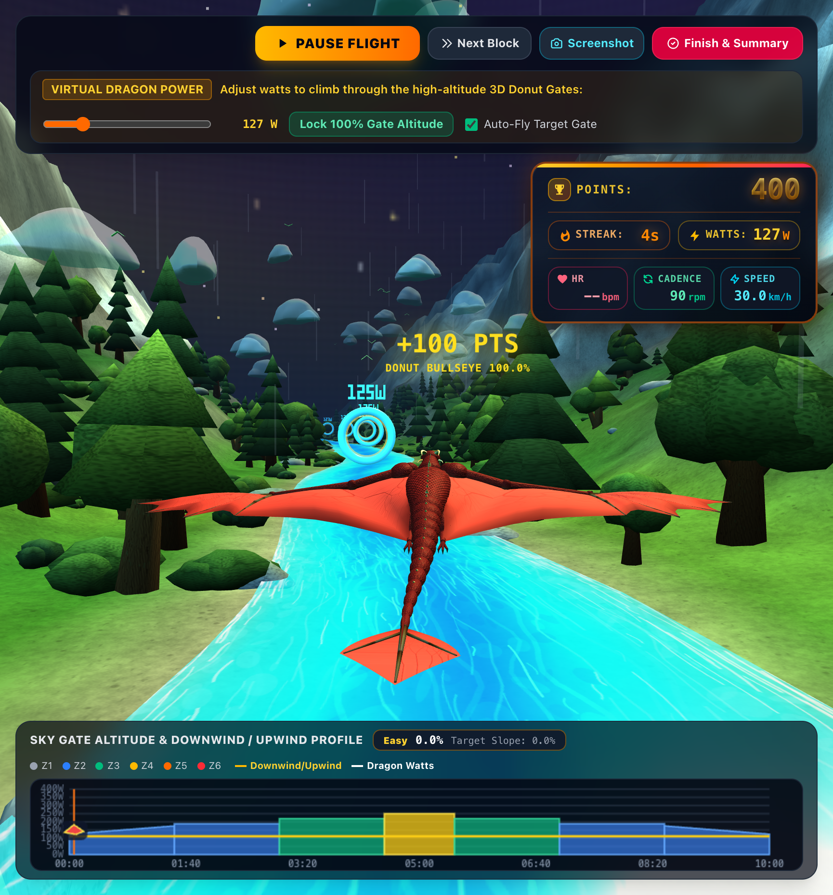
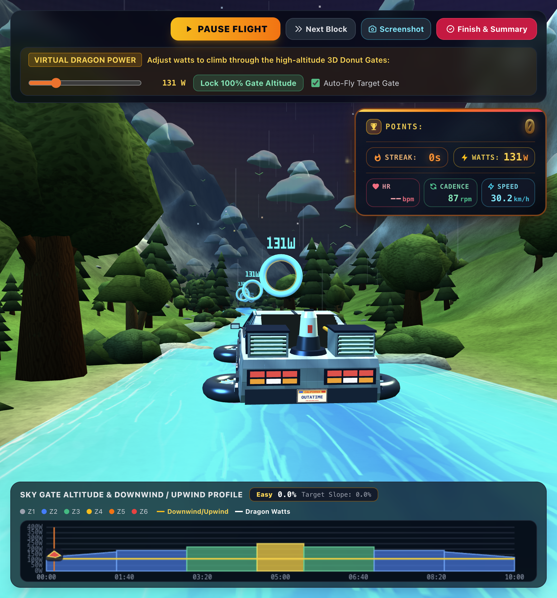
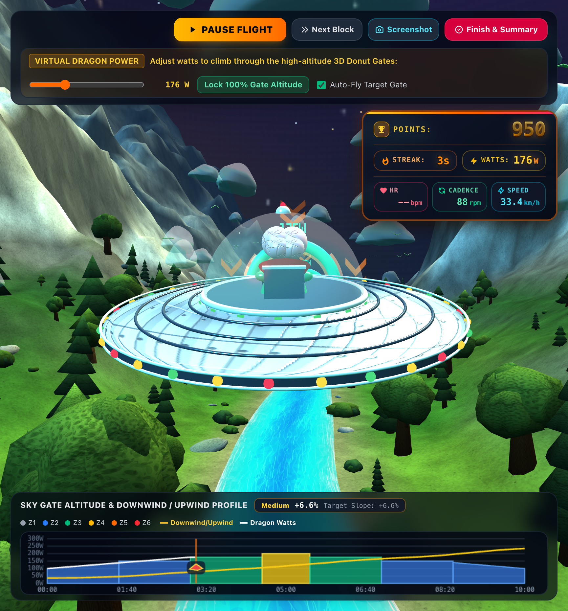
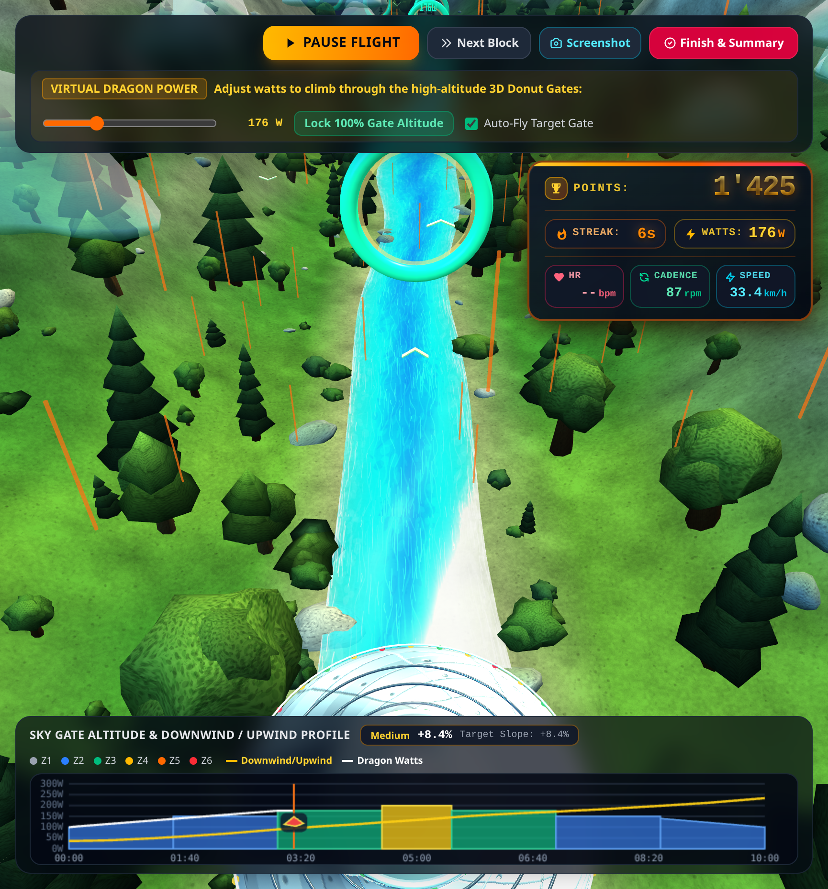
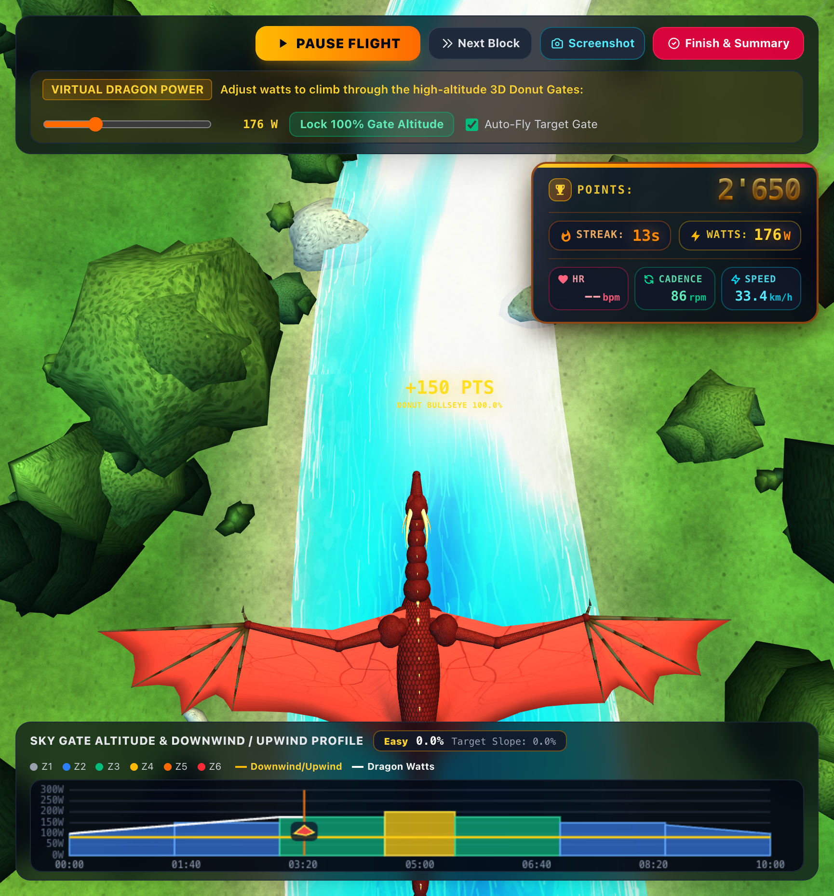
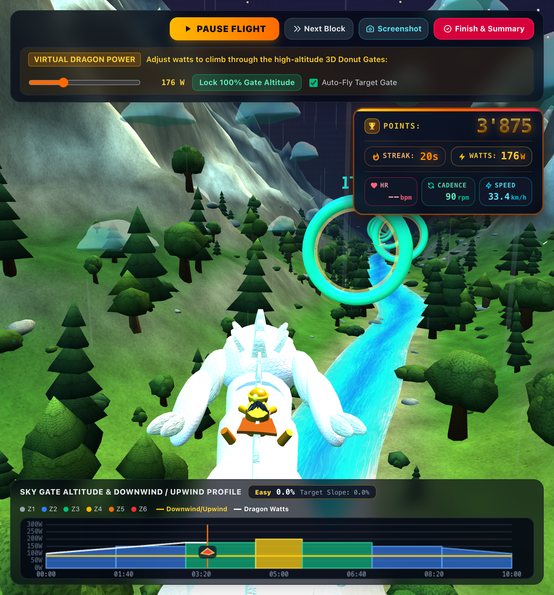
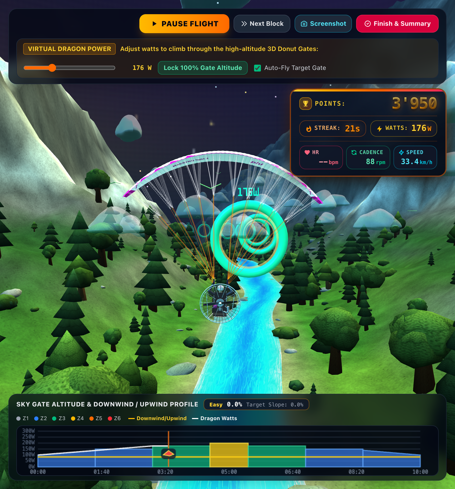
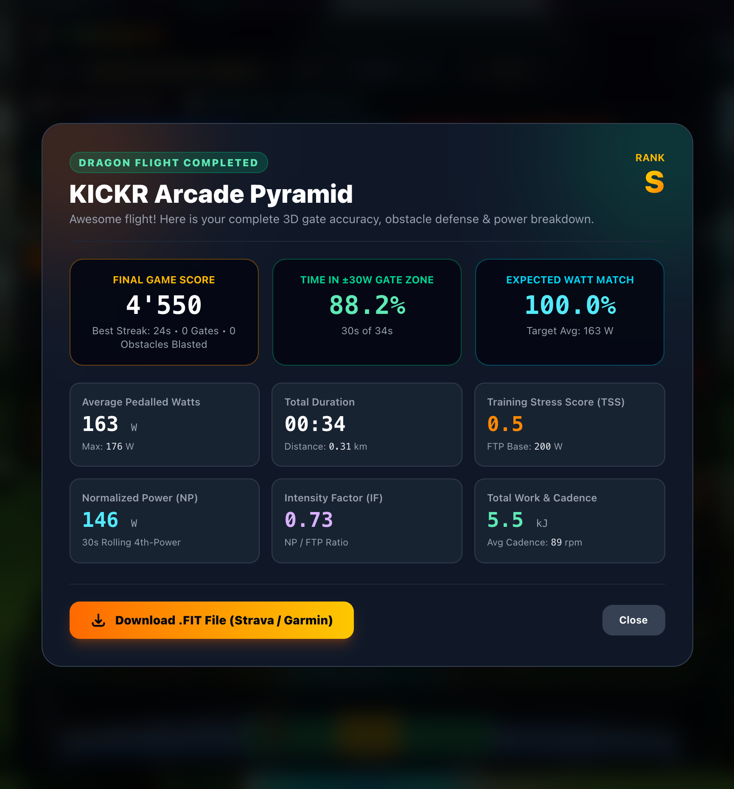

# Performed 3D

Performed 3D is a browser-based 3D cycling game for structured indoor cycling workouts. A workout profile sets power targets; power from a connected trainer is measured and its resistance is controlled according to the selected mode. At the same time, an avatar flies through an animated sky filled with donut gates. Optionally, you can shoot obstacles and steer manually.



## Feature Requests

- Ghost ride
- Multiplay
- Settings GUI (GUI Cleanup)
•⁠  ⁠splashscreen
•⁠  ⁠pairing-screen
•⁠  ⁠avatar uswahl
•⁠  ⁠game
•⁠  ⁠summary
-- Optimize screen to see current watt and cadence more performant
- Ranking server

## Quick start

There is no build step or package installation. Node.js 18 or newer is required to run the local web server. The page loads Three.js and Tailwind CSS at runtime from CDNs, so an internet connection is required.

1. Clone or download the repository.
2. Start the app from the project directory:

   ```bash
   node server.js
   ```

   To change the port or origin, copy `.env.example` to `.env`, edit it, and load it first (`set -a; . ./.env; set +a`).
3. Open <http://localhost:8000/performed3d.html> in your browser.
4. Choose a workout and resistance mode, set your FTP and accuracy, then click **Start Flight**.

Simulation mode is enabled by default, so you can try the game without a trainer. Bluetooth requires a compatible browser; the Web Bluetooth API is supported by browsers such as current versions of Chrome and Edge. Bluetooth is available only in a secure context (for example, `localhost` or HTTPS).

For an HTTPS deployment behind a reverse proxy, set `APP_ORIGIN` to the public origin in the server environment.

## Gameplay and workout controls

Your current power is compared with the workout's target power. The game displays power accuracy, workout intervals, and progress in the HUD. FTP (200 W by default; adjustable from 50 to 600 W) is used to calculate power targets specified as a percentage of FTP. Use **Donut / Accuracy** to set the allowed power deviation (30 W by default).

Available workouts include:

- **KICKR Arcade Pyramid** and **Quick 3-Minute Accuracy Sprint** for short accuracy challenges
- Ramp and elevation profiles such as **Sky Serpent**, **Alpine Switchback**, **Mach Canyon**, and **Dragon Boss Mega-Ramp**
- Interval workouts such as **30/15 VO2max Micro-Burst Storm**, **Dragon Fire Tabata Inferno**, and **Over-Under Surge Blitz**
- Longer profiles such as **Harmonic Wave & Step Matrix**, **Sweet Spot Precision**, and **Pro Criterium Corner Sprints**
- Custom Zwift workouts in `.zwo` format

Resistance modes are **Easy**, **Medium**, **Difficult**, and **ERG Lock**. In **Medium** and **Difficult** modes, simulated upwind thermals and downwind drafts are shown directly on upcoming donut gates with animated emerald lift or amber draft 3D chevrons, flanking wind halos, and slope badges. Use **Next Block** to skip to the next interval. **Start Flight** pauses or resumes the workout. You can also end a workout early.

### Adaptive music

While flying, a procedurally generated soundtrack (Web Audio, no audio files) follows the target power of the next ring (donut gate) ahead, relative to FTP. Your actual pedaled watts do not affect it, so the music tracks the workout's intervals. Tempo, key, instruments, and brightness change with the ring targets:

| Mood | Ring target (% FTP) | Sound |
| --- | --- | --- |
| **Drift** | < 35 % | 76 BPM, soft major pads and sparse bells, no drums |
| **Cruise** | 35–68 % (warm-up/cool-down) | 92 BPM, warm pads, soft kick, gentle arpeggio |
| **Groove** | 68–90 % | 112 BPM, groove beat, plucked bass, 8th-note arpeggio |
| **Drive** | 90–106 % | 128 BPM, minor key, four-on-the-floor, saw bass, 16th-note arpeggio |
| **Inferno** | > 106 % | 146 BPM, full drums with fills, rolling bass, sawtooth lead |

Transitions are smoothed so short target changes don't toggle the music. The music (note) button in the header turns the soundtrack on or off. The speaker button mutes all audio, including the music; while muted, the music button is disabled.

## Controls

| Key | Action |
| --- | --- |
| `←` / `A` | Steer left |
| `→` / `D` | Steer right |
| `1`–`5` | Change camera view |
| `Space` | Breathe dragon fire to fend off obstacles |
| `↑` / `↓` | Increase/decrease power by 10 W in simulation mode |
| `Shift` + `↑` / `↓` | Increase/decrease power by 25 W in simulation mode |

You can turn off manual steering to have the avatar automatically steer through the gates. The left, right, and center buttons in the compact control bar are alternatives to the keyboard. Obstacles can be enabled or disabled with the corresponding option.

## Avatars and cameras

Available avatars:

- Aero Wyvern
- Fuchur
- Boy with Bicycle & E.T.
- DeLorean
- UFO
- Paramotor (pilot with a caged propeller under a white/lilac Phi Maestro Light 3 paraglider)

There are five camera views: Chase, Far Chase, Top-Down, Front, and Front Far. Your avatar, camera, FTP, steering, and accuracy settings are saved in the browser.

## Connecting trainers and sensors

Use the BLE buttons to pair supported devices:

- Wahoo KICKR (power and trainer control)
- Concept2 RowErg, SkiErg, or BikeErg via the PM5 monitor (power, stroke rate shown as cadence, speed, and heart rate from a strap paired to the PM5). The PM5 cannot be controlled, so resistance modes and ERG Lock have no effect; you set the effort yourself.
- Heart rate monitors
- Cadence and speed sensors
- Elite Sterzo Smart or Elite Rizer (BLE steering)
- Mobile phone handlebar steering via QR code (WebRTC peer-to-peer): Click **Phone Steer (QR)** on the desktop to display a QR code. Scanning it on your phone opens a minimalistic mobile steering controller page (`?phone-steer=<id>`) with sensor permission handling, live angle gauge, **Calibrate Center (0°)**, axis inversion, touch test slider, and a **Dragon Fire** button—without requiring `server.js` or typing IP addresses.
- Elite Aria Smart Fan

Bluetooth devices must be powered on and within range. Start pairing from the corresponding control in the interface. Without a trainer, use simulation mode; power can be adjusted with the slider or arrow keys.

### Automatic reconnection

Previously paired Bluetooth devices reconnect automatically when the page loads and whenever they come back into range. This uses the Web Bluetooth `getDevices()` API, which is enabled by default only from Chrome 169. In earlier Chrome or Edge versions, enable it manually:

1. Open `chrome://flags/#enable-web-bluetooth-new-permissions-backend` (in Edge: `edge://flags/#enable-web-bluetooth-new-permissions-backend`).
2. Set the flag to **Enabled** and restart the browser.
3. Pair each device once more using its button so that the browser remembers the permission.

Without this flag, devices must be paired manually after every page load. Messages prefixed with `[BLE auto-connect]` in the browser console show which devices were found and whether a connection succeeded.

## Custom workouts and results

- **Load a Zwift workout:** Select a `.zwo` file using **Upload Zwift (.zwo)**. Supported interval types include SteadyState, Warmup, Cooldown, Ramp, IntervalsT, FreeRide, and MaxEffort.
- **Save a FIT file:** After the workout, download the recorded activity as a `.fit` file from the summary and import it into Strava, Garmin Connect, or another training platform.
- **Garmin Connect:** Direct activity uploads require access to Garmin's Business Developer Program Activity API, which provides push access. Garmin's personal API access is pull-only. Until business access is available, download the FIT file and import it into Garmin Connect manually.
- **Save a screenshot:** Capture a screenshot before or during a workout; it will be available to download from the summary.
- **Ghost rides:** Click **Save Ghost Ride** in the summary to download the ride as a `.ghost.json` file. The file contains the workout plus your watts, distance, and score for every second. Before starting a ride, click **Load Ghost** to race against a saved ride; its workout is loaded automatically. A translucent cyan copy of your avatar flies beside you. Its altitude follows the ghost's watts, and it moves ahead or behind according to the distance gap. The HUD shows your distance gap, the ghost's watts, and your score difference, and the summary reports who won. Selecting a different workout removes the ghost; you can also remove it with **✕** next to its status chip.

## Screenshots

| View | Screenshot |
| --- | --- |
| Flight |  |
| DeLorean avatar |  |
| UFO, standard view |  |
| UFO, top-down view |  |
| Front camera |  |
| Fuchur avatar |  |
| Paramotor avatar |  |
| Workout summary |  |

## Project files

- [`performed3d.html`](performed3d.html) – User interface, game, workout logic, and Bluetooth integration
- [`server.js`](server.js) – Local static web server
- [`.env.example`](.env.example) – Example server configuration
- [`performed3d-models.js`](performed3d-models.js) – 3D models
- [`sterzo-challenge-codes.js`](sterzo-challenge-codes.js) – Sterzo challenge/response table; the source code attributes it to `pycycling` under the MIT license
- [`performed3d.svg`](performed3d.svg) – Logo and favicon
- [`docs/screenshots/`](docs/screenshots/) – Documentation screenshots
